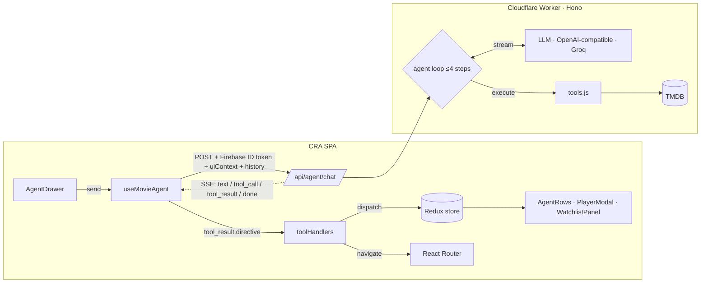

# NETSTREAM Agent Architecture

How NETSTREAM's AI assistant works: it finds movies, plays trailers and curates watchlists by driving the existing React/Redux UI. The app stays a CRA single-page app. The only backend is one Cloudflare Worker.

---

## 1. Codebase audit (before this change)

| Area | Finding | Impact on the agent |
|---|---|---|
| Bundler | **Create React App** (`react-scripts 5`), React 18, Tailwind 3. Env vars are `REACT_APP_*` and **get baked into the public bundle**. | No secret can live in the client. LLM and TMDB keys must stay server-side. |
| Routing | React Router v6 `createBrowserRouter`, routes `/` (login) and `/browse`. The router was **built inside `Body`'s render**. `react-router-dom` was listed under **devDependencies**. | The agent needs `navigate()`, so the drawer has to render *inside* the router. Fixed: the router now lives at module scope with a layout route, and the dependency moved. |
| State | **Redux Toolkit**, one store with 4 slices: `user`, `movies` (now playing, popular, top rated, upcoming, Trailer), `Gpt` (AI-search toggle + results), `Config` (lang). | Good hook point. Agent actions are plain RTK actions, and any component already reacts to them. |
| "Views" | AI Search vs Home is a **boolean toggle** (`Gpt.showgptsearch`), not a route. | The agent can't safely flip a toggle without knowing its current value. Added `setGptsearch(bool)`. |
| TMDB | Fetch hooks call a Cloudflare Worker as `?url=<any TMDB url>`. | That is an **open proxy**: anyone can use your TMDB key, with no allowlist. Replaced by `GET /api/tmdb/*` with path allowlisting (optional migration). |
| LLM | `GroqApi.js` → Worker → Groq. A single prompt returns comma-separated titles, then **10 separate TMDB searches** (N+1 fan-out). The user query is pasted straight into the prompt. `Openai.js` uses `dangerouslyAllowBrowser` (unused). `openai`, `@google/genai` and `dotenv` are unused dependencies. | The agent replaces text parsing with **structured tool calls**. Remove the dead SDKs. |
| Player | The Play / More Info buttons had **no handlers**. `MovieCard` wasn't clickable. The only video is the hero background trailer, stored in a *global* `movies.Trailer`. | Added a `player` slice and a `PlayerModal`. Cards and the hero now open it. |
| Auth | Firebase Auth (email/password). `onAuthStateChanged` runs in `LoginPage`, which mounts on both pages. | We reuse the Firebase **ID token** to authenticate gateway calls. No new auth system. |
| Misc | `build/` is committed. Hooks have missing effect deps (`UseMovieTrailer(movieid)` won't refetch). | Not blocking. Clean up separately. |

**Where the Agent Controller hooks in:** the Redux store, through action creators, plus the router's `navigate`. Both are reachable from one React hook rendered inside `<Provider>` and `<RouterProvider>`.

---

## 2. Architecture



### Why a thin edge gateway, not Next.js and not browser-direct

- **Browser-direct is not an option.** CRA inlines env vars into the bundle, so any key there is public.
- **Hono on Cloudflare Workers** is the right size. You already deploy Workers, cold starts are near zero, it streams SSE natively, the edge caches TMDB responses, and Workers Rate Limiting is a built-in binding. Hono keeps it portable: the same code runs on Vercel, Deno or Node if you move.
- **The server owns the loop and the client owns the UI.** The model ↔ tool round trips happen server-side, next to TMDB and the keys. The browser only receives **directives**: small, typed instructions like `SHOW_MOVIE_ROW`. The model can never run arbitrary code or dispatch arbitrary actions.
- **Stateless:** the gateway stores nothing. The client sends back the transcript the gateway returned last turn. It's capped and sanitized server-side (roles whitelisted, `system` dropped, trimmed to start at a user turn).

### State loop for one turn

1. The user types in `AgentDrawer`. `useMovieAgent.send()` dispatches `turnStarted`, which adds the user bubble and an empty assistant bubble.
2. The hook sends `POST /api/agent/chat` with `{ input, history: agent.transcript, uiContext }`. `uiContext` is a compact snapshot (route, view, visible rows as `id|title`, open player, watchlists), so "play the second one" resolves without an extra round trip.
3. The gateway verifies the Firebase JWT (`jose` + Google JWKS) and applies the per-uid rate limit. It then streams the LLM, forwarding tokens as `text` events.
4. If the model emits `tool_calls`, the gateway sends a `tool_call` event for each one, which shows a spinner chip. The tools run in parallel against TMDB. Each produces:
   - `result` – a compact summary (ids and titles only) that goes back to the model, and
   - `directive` – the UI payload, sent as a `tool_result` event.
5. **Client tool callback:** `applyToolResult()` checks that the directive type matches the tool, re-validates the cards, and dispatches (`addAgentRow`, `openPlayer`, `createWatchlist`). If needed it calls `setGptsearch(false)` and `navigate('/browse')`, then scrolls the new element into view. The chip turns into a ✓ with a label.
6. The loop repeats (up to 4 steps) until the model answers in plain text. `done` returns the turn's transcript, which goes into `agent.transcript` for the next turn.
7. **Stop** aborts the fetch. The Worker's `onAbort` cancels the upstream LLM request, so you don't pay for tokens nobody will read.

---

## 3. Tools

Full JSON schemas: [`agent-gateway/src/tools.js`](../agent-gateway/src/tools.js) (`TOOL_SCHEMAS`). Client halves: [`src/agent/toolHandlers.js`](../src/agent/toolHandlers.js).

| Tool | Model fills | Server does | Directive → client action |
|---|---|---|---|
| `filter_and_display_movies` | `row_title`, `intent_summary`, `with_genres[]` (enum), `without_genres[]`, `keywords[]`, `similar_to_title`, `title_query`, year range, `min_rating`, `max_runtime_minutes`, `original_language`, `sort_by`, `placement` | Resolves keyword names to ids, or a seed title to recommendations, then `/discover/movie`. Adds a vote-count floor when sorting by rating. Drops titles with no poster. | `SHOW_MOVIE_ROW` → `addAgentRow` + navigate + scroll |
| `play_or_preview_title` | `movie_id` **or** `title_query` (+`release_year`), `mode: play\|preview` | Details + videos in parallel. Picks the official YouTube trailer, then any trailer, then a teaser. | `OPEN_PLAYER` → `openPlayer` (muted preview or full-screen with sound) |
| `curate_mood_watchlist` | `name`, `mood`, `seed_titles[]`, `with_genres[]` (OR), `avoid_genres[]`, `max_runtime_minutes`, `size`, `ordering: best_first\|escalating\|wind_down\|chronological` | Seed recommendations plus genre discovery. Dedupes, ranks by rating, then orders by a genre-based intensity heuristic. | `CREATE_WATCHLIST` → `createWatchlist` (saved to localStorage), then `WatchlistPanel` offers play all, reorder and remove |
| `check_where_to_watch` | `movie_id` **or** `title_query` (+`release_year`), optional `region` | Details + `/movie/{id}/watch/providers` in parallel; picks `results[region]`. | `SHOW_WATCH_PROVIDERS` → `openPlayer` in preview mode with a `providers` block |

`filter_and_display_movies` also accepts `streaming_on[]` (free-text service names) and `region`. The gateway fuzzy-matches names against `/watch/providers/movie?watch_region=…` (cached 24h per Worker isolate, never hardcoded ids) and passes `with_watch_providers` / `watch_region` / `with_watch_monetization_types=flatrate` to discover. Names that don't match come back as `result.unmatched_services`; if *none* match, no row is shown and the model says so. `streaming_on` is ignored for `title_query` / `similar_to_title` searches. `play_or_preview_title` also fetches providers (best-effort) and ships them in `OPEN_PLAYER.providers`.

Region lives in `ConfigSlice.region` (default `IN`), is sent in `uiContext.region`, and the gateway validates it as `^[A-Z]{2}$`. `PlayerModal` lazily fetches providers (`/api/tmdb/movie/{id}/watch/providers`) when a card opens without them. Streaming data is by JustWatch, and the modal shows that attribution.
| `identify_movie_from_description` | `description`, `remembered{years, language, actors}`, up to 5 `candidates{title, year, reason, confidence}` | **The model proposes, the server verifies.** Each title is searched on TMDB and only counts if the hit's title really matches (TMDB search is fuzzy, so a made-up title can still return an unrelated film). Unverified candidates are dropped. Confidence −0.2 outside the remembered year range, +0.15 if a named actor is in the cast (`/search/person` + `/person/{id}/movie_credits`). | `SHOW_CANDIDATES` → `candidatesShown`, rendered by `CandidatePicker` under the assistant message. If nothing verifies: `{found: 0}`, no directive, and the model asks one clarifying question. |
| `create_watch_party` | `name`, 2-6 `members{name, likes_genres, hard_no_genres, loved_titles}`, `max_runtime_minutes`, `services[]`, `region` | Hard no's from anyone become vetoes (`without_genres`) for the whole group. Candidate pool = discover on the OR of everyone's likes (runtime, providers, vote floor applied) + recommendations for every loved title. Recommendation-sourced movies are re-checked for runtime and service availability (details + providers, capped at 12). Ranked **least-misery**: worst member score first, then mean + `0.1 × (rating − 6)`. Top 8 kept, each with a `whyEveryone` line. The server does **not** write to Firestore. | `CREATE_WATCH_PARTY_DRAFT` → client writes `parties/{id}` as the signed-in host, navigates to `/party/:id` |

"Yes, that's it" sends a normal chat turn; the system prompt tells the model to chain `check_where_to_watch` + `filter_and_display_movies(similar_to_title)` in that single turn.

Design choices that keep tool calls reliable:

- **Genres are an enum of names**, not TMDB ids. Models hallucinate ids; the server maps names to ids.
- **`additionalProperties: false`** and tight bounds (`maxItems`, `minimum`/`maximum`).
- **Tool errors are returned to the model** as `{ error }` instead of throwing, so it can retry with looser filters once.
- **The model never sees overviews**, only `id|title (year) ★rating`. This saves tokens and closes the prompt-injection path through TMDB text.

### Watch party (Firestore)

The only persistent shared state in the app. The gateway stays stateless: it returns a draft, and the **client** creates the document as the signed-in host, so security rules (not the gateway) are the authority.

```
parties/{partyId}
  hostUid, name, createdAt (ms), expiresAt (createdAt + 48h), status: "voting" | "locked"
  constraints: { maxRuntime, region, services[] }
  members: { [uid]: { displayName, joinedAt } }
  candidates: [ card + { fitScore, whyEveryone } ]      // max 8, overview trimmed to 240 chars
  votes: { [uid]: { [movieId]: 1 | -1 } }
  winnerId: number | null
```

`firestore.rules` (registered in `firebase.json`):

| Who | Can |
|---|---|
| Any signed-in user, incl. anonymous guests | read a party |
| Real (non-anonymous) account | create a party, only with `hostUid == own uid`, `status: "voting"`, no votes, no winner, ≤ 8 candidates, `createdAt` within ±60s of server time and `expiresAt = createdAt + 48h` |
| Host | change `candidates`, `status` (`voting`/`locked`) and `winnerId`, nothing else |
| Any member (host included) | write only `members.<own uid>` (valid name) and `votes.<own uid>` (each value `1` or `-1`, ≤ 8 entries, only after joining) |
| Everyone | nothing once `status == "locked"` or past `expiresAt`; nobody can delete |

Rules use `request.resource.data.diff(resource.data).affectedKeys()` for the top-level fields and `Map.diff` on `members` / `votes` so a user can't touch another user's entry. Known limit: rules can't iterate a map, so vote *keys* aren't checked against candidate ids (a member can only add junk keys to their own vote map, capped at 8).

Guests sign in anonymously on `/party/:id`. `LoginPage` treats anonymous users as signed-out for everything else (no redirect into `/browse`, `/` still needs a real account) and leaves them alone on `/party/*`. The winner is `pickWinner()` in `src/agent/party/partyLogic.js`: highest net votes, ties broken by `fitScore`.

Tests: `npm run test:rules` runs `firestore-tests/rules.test.mjs` against the Firestore emulator (needs Java 11+). `npm run test:gateway` runs the Worker tests.

---

## 4. Files

```
agent-gateway/                 Cloudflare Worker (Hono)
  src/index.js                 routes, auth/rate-limit middleware, agent loop, SSE, TMDB proxy
  src/llm.js                   OpenAI-compatible streaming client, accumulates tool_call deltas
  src/tools.js                 TOOL_SCHEMAS + server executors
  src/tmdb.js                  allowlisted TMDB client, genre map, card shaping
  src/auth.js                  Firebase ID token verification (jose)
  test/agent.test.mjs          end-to-end loop test with mocked LLM/TMDB/JWKS
  wrangler.toml
src/agent/
  useMovieAgent.js             chat loop hook (stream, tool callbacks, stop/retry/reset)
  agentClient.js               SSE-over-fetch parser
  toolHandlers.js              directive → dispatch/navigate (client security boundary)
  uiContext.js                 screen snapshot sent each turn
  tmdbClient.js                trailer lookup for cards and watchlist items
  components/AppShell.js       layout route: <Outlet/> + PlayerModal + AgentDrawer
  components/AgentDrawer.js    slide-over assistant (⌘/Ctrl+K, Esc, stop, retry, suggestions)
  components/PlayerModal.js    trailer player with preview/play modes and queue
  components/AgentRows.js      agent-created rows above the stock rows
  components/WatchlistPanel.js interactive mood playlist
src/utils/agentSlice.js · playerSlice.js · watchlistSlice.js     new slices
src/utils/movieSlice.js (+agentRows) · GptSlice.js (+setGptsearch) · AppStore.js   extended
src/component/Body.js · MovieCard.js · MovieList.js · VideoTitle.js · MainContainer.js · SecondaryContainer.js   wired
```

---

## 5. Run it

```bash
# Gateway
cd agent-gateway && npm install
wrangler secret put LLM_API_KEY        # Groq key (or any OpenAI-compatible provider)
wrangler secret put TMDB_READ_TOKEN    # TMDB v4 "API Read Access Token"
npm test                               # offline loop test
npm run dev                            # http://localhost:8787  (use .dev.vars for local secrets)
npm run deploy

# App
cp .env.example .env                   # set REACT_APP_AGENT_URL to the deployed worker URL
npm start
```

Update `ALLOWED_ORIGINS` and `LLM_MODEL` in `wrangler.toml`. Pick a model your provider lists as supporting tool use.

---

## 6. Production hardening and next steps

- **Migrate the browse hooks** from the open `?url=` proxy to `/api/tmdb/*`, then delete the old worker so your TMDB key stops being publicly usable.
- **Remove** `openai`, `@google/genai`, `dotenv` and `src/utils/Openai.js`. Stop committing `build/`.
- **Observability:** log `{uid, step, tool, latency, tokens}` per turn (Workers Analytics Engine or Logpush). Add an eval set of about 30 prompts that asserts tool choice and arguments.
- **Cost controls:** `max_tokens` is 800 and the loop is capped at 4 steps. Add a daily per-uid token budget in KV or Durable Objects.
- **Watchlists in the cloud:** swap the localStorage subscriber for Firestore (keyed by uid). The slice API stays the same.
- **Confirmation-gated tools:** for future side-effecting tools (share a list, rate a movie), have the gateway emit a `confirm` event. The drawer renders Approve/Deny and resends with the user's decision in `history`.
- **Retire the old AI Search page**, or reimplement its submit as `send()` so there's one AI path.
